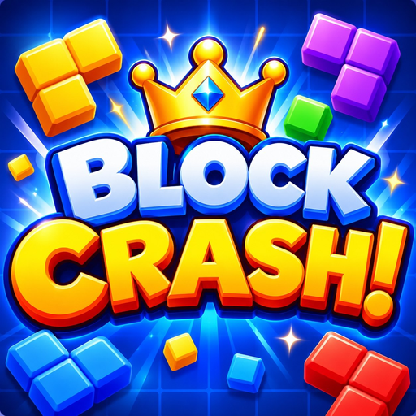

# 👑 BLOCK CRASH! — Mobil Blok Boshqotirma O'yini (Godot 4)

Ushbu loyiha mashhur **"Block Blast / Block Crash"** uslubidagi to'liq tayyor mobil o'yin bo'lib, **Godot Engine 4.x** (GDScript) da yaratilgan.



---

## 🎮 O'yin mexanikasi va xususiyatlari

1. **8x8 O'yin maydoni:**
   - 8 qator va 8 ustundan iborat yorqin, zamonaviy dizayndagi bloklar katagi.
   - Har bir katak 3D-bevel va yaltiroq gloss effektiga ega.

2. **Sensorli boshqaruv (Touch & Drag):**
   - Ekranda barmoq bilan figurani ushlaganda u avtomatik ravishda barmoqdan **180 piksel yuqorida (Finger Offset)** suzadi — bu orqali o'yinchi barmoq tagidagi maydonni bemalol ko'ra oladi.
   - Slotda turgan figura 0.55 masshtabda joylashadi, ushlab tortilganda esa silliq animatsiya bilan 1.0 (haqiqiy o'yin o'lchami) ga kattalashadi.

3. **Ghost Preview (Soya ko'rsatkichi):**
   - Figurani maydon ustiga olib borganda, u tushishi mumkin bo'lgan kataklar yarim shaffof rangda yoniq ko'rsatiladi.

4. **Portlash (Crash) va Kombo tizimi:**
   - Qator yoki ustun to'liq to'lganda, bloklar chiroyli pop-animatsiya bilan portlaydi.
   - Ketma-ket qatorlarni tozalaganda **COMBO x2, x3, x4** ko'paytiruvchilari ishlaydi.
   - Ekranda dinamik ravishda *"CRASH!"*, *"DOUBLE CRASH!"*, *"COMBO x2!"*, *"UNBELIEVABLE!"* animatsion yozuvlari chiqadi.

5. **Ovoz effektlari (Audio):**
   - Blokni ushlash (Pickup)
   - Maydonga qo'yish (Place)
   - Qator tozalanishi (Clear)
   - Kombo ovozi (Combo — pitch ortib boradi)
   - O'yin tugashi (Game Over)
   - Ovozni yoqish/o'chirish (Mute) tugmasi.

6. **Rekord va Natija:**
   - Eng yuqori ball (Best Score) qurilma xotirasida saqlanadi (`user://block_crash_save.json`).
   - O'yin tugaganda natijalar oynasi va "Qayta o'ynash" tugmasi chiqadi.

7. **Adolatli figura berish (Fair RNG):**
   - Har safar pastda 3 ta figura hosil bo'ladi. Tizim kamida bitta figura maydonga sig'ishi kafolatlanganini tekshiradi.

---

## 📁 Loyiha tuzilishi

```
block-crash/
├── project.godot            # Godot 4 asosiy konfiguratsiyasi (1080x1920 portrait)
├── export_presets.cfg       # Android APK va Web (HTML5) eksport sozlamalari
├── assets/
│   ├── icon.png             # O'yin logotipi va ikonkasi (512x512)
│   ├── block.png            # 3D uslubdagi yaltiroq blok teksturasi
│   ├── cell_bg.png          # Maydondagi katak foni
│   ├── crown.png            # Rekord uchun oltin toj ikonkasi
│   └── sounds/              # 5 ta toza sintez qilingan WAV ovozlar
├── scenes/
│   ├── Main.tscn            # Asosiy o'yin sahnasi (Fon, UI, Board, Spawner)
│   ├── Board.tscn           # 8x8 Maydon sahnasi
│   ├── Cell.tscn            # Bitta katak sahnasi
│   ├── Piece.tscn           # Harakatlanuvchi figura sahnasi
│   └── FloatingText.tscn    # "COMBO!", "CRASH!" suzuvchi yozuvlar
└── scripts/
    ├── Main.gd              # O'yin boshqaruvchisi, ball va rekordlar
    ├── Board.gd             # Maydon mantig'i va qatorlarni portlatish
    ├── Cell.gd              # Katak animatsiyalari va holatlari
    ├── Piece.gd             # Sensorli sudrab tashlash (Drag-and-drop)
    ├── Spawner.gd           # 3 ta figurani boshqarish va Game Over tekshiruvi
    ├── ShapesData.gd        # Shakllar matritsalari va yorqin ranglar
    ├── AudioManager.gd      # Ovozlar ijrochisi
    └── FloatingText.gd      # Suzuvchi matn animatsiyasi
```

---

## 🚀 Qanday ishga tushiriladi?

### 1. Kompyuterda ochish va o'ynash:
1. [Godot Engine 4.3 yoki 4.2+](https://godotengine.org/download) ni yuklab oling (o'rnatish shart emas, bitta `.exe` fayl).
2. Godot'ni oching va **"Import"** tugmasini bosing.
3. Ushbu papkadagi `project.godot` faylini tanlang va **"Import & Edit"** ni bosing.
4. **F5** tugmasini yoki yuqori o'ng burchakdagi **Play (▶)** tugmasini bosing! O'yin darhol kompyuteringizda ishga tushadi. Sichqoncha orqali barmoq kabi o'ynash mumkin.

### 2. Android telefonga APK qilib chiqarish:
1. Godot ichida: `Project -> Export...` bo'limiga kiring.
2. Ro'yxatdan **"Android"** ni tanlang (sozlamalar `export_presets.cfg` da tayyorlangan).
3. **"Export Project"** tugmasini bosib, `BlockCrash.apk` faylini saqlang va telefoningizga o'rnating!
